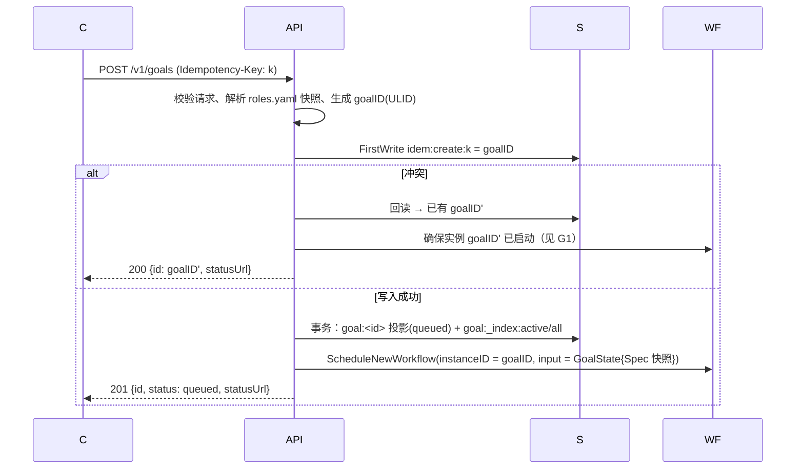
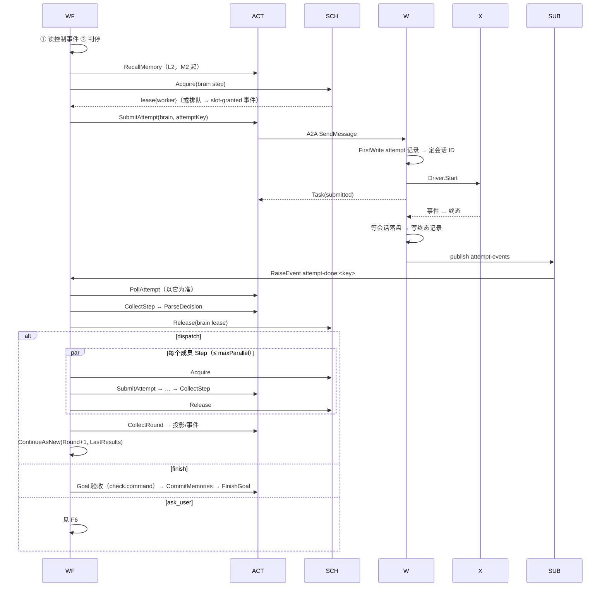

# my-bot 流程梳理

> 2026-10-21。按 `docs/spec.md` 把每条关键流程从头走到尾，目的是在写代码前找出 spec 的缺口和矛盾。
> 每个流程末尾的「⚠ 缺口」是走查中发现的问题，编号 G1…；汇总和建议见文末《缺口汇总》。
> **状态（2026-10-21）**：G1–G18 已全部写回 spec；G3（单一 Scheduler Actor）与 G8（共享工作区卷）按建议采纳，用户可否决。

## 0. 参与者

| 简称 | 组件 |
| --- | --- |
| C | 客户端（curl / mybotctl / 将来的飞书） |
| API | Runtime HTTP 层 |
| WF | Runtime 中的 GoalWorkflow（Dapr Workflow，确定性代码） |
| ACT | Runtime 中的 Activity（可做 IO） |
| SCH | 槽位 Actor（spec 中为 `SlotPool`） |
| SUB | Runtime 中的 `attempt-events` 订阅处理 |
| W | Worker（A2A 服务 + Driver） |
| X | 执行器进程（pi / codex / fake） |
| S | Dapr State（Redis） |
| MW | `MemoryWriter` Actor |
| M0 | mem0 |

---

## F1 创建 Goal



要点：
- `Spec` 在创建时固化：角色定义、指令文件内容的 sha256、limits。之后改 `roles.yaml` 不影响在途 Goal。
- 客户端拿到 ID 即可断开（§12 第 1 条）。

⚠ 缺口
- **G1 创建的崩溃窗口**：`idem` 写成功后、Workflow 启动前 Runtime 崩溃，客户端重试会拿到 ID，但实例从未启动。修正：命中 `idem` 时，API 检查实例是否存在，不存在就以同一 goalID 补启动（实例 ID 固定，重复启动由 Dapr 拒绝，可当成功处理）。投影写入同理可补。
- **G2 投影的写者**：spec 说「投影只由 Activity 写入」，但创建时的 `queued` 投影由 API 写。修正：明确为「创建时由 API 写初始投影，之后只由 Activity 写」。

---

## F2 一轮（brain 策略）



⚠ 缺口
- **G3 三级槽位的「持有并等待」**：spec 让 Workflow 先取 `global` 再取 `<executor>/<account>`，取不到第二个就释放第一个。这样在排队时 Workflow 要在两个 Actor 之间来回重试，事件到达和重新获取之间有竞态，还可能出现：global 槽被一批等 Codex 的 Goal 轮流占住，Pi 的任务饿死。**建议**：合并成一个 `Scheduler` Actor（单实例），在一次调用里原子地检查全局、账号、Worker 实例三级容量，并直接选出 Worker 实例，lease 里带 `workerID`。个人规模下单 Actor 吞吐足够，同时消除死锁和竞态，Worker 选择也因此变成确定的（Actor 返回值会被 Workflow 记录）。**待确认**。
- **G4 Worker 选择不能放在 Workflow 里**：「从注册表 round-robin 选实例」需要读 State，属于 IO，不能在 Workflow 代码里做。按 G3 的建议由 Scheduler Actor 完成；不采纳 G3 时也必须放进一个 Activity。
- **G5 会话亲和**：`reuse` 的会话存在某个 Worker 的 PVC 上，下一轮必须派回同一个 Worker，否则会话找不到。spec 只在风险表里提了一句。修正：Acquire 请求带 `preferWorker`（同 Goal + 角色上次的 Worker）；该实例满载时等待最多 `affinityWait`（默认 5 分钟），超时或实例已注销则换实例，并把本次 `sessionPolicy` 改为 `fresh`（大脑靠进展摘要续上）。
- **G6 大脑提示词里的 `[progress]` 由谁生成**：Runtime 不调用模型。修正：`Progress` 取大脑本轮决策的 `summary`（确定性策略下取成员输出的 `summary`），截断到 4 KiB；不另做模型摘要。
- **G7 产物路径不一致**：§2 写 `/data/artifacts/<goalID>/r<round>/`，§7.1 的 URI 只到 `r<round>/<name>`，登记键却是 `<round>/<step>/<name>`，§5.3 示例用 `r2/design/design.md`。修正：统一为 `r<round>/<stepID>/<name>`，并把登记键 `goal:<id>:artifact:r<round>/<stepID>/<name>` 补进 §6 的键表。

---

## F3 成员 Step 与工作区

走查一个典型协作：designer（Pi）在 r1 写设计；r2 中 coder（Codex）和 reviewer（Codex）并行，分别改代码和写测试；r3 中 reviewer 合并并跑 check。

问题出在**工作区跨 Pod**：
- spec 中每个 Worker Pod 有自己的 PVC，`workspace` 是 Worker 本地目录。
- Pi Worker 和 Codex Worker 是不同的 Pod。designer 的设计文档可以靠「产物交接」拷过去；但「同一个代码仓库」这种有状态的工作区，在不同 Pod 上是两份互不相干的拷贝。r3 的 reviewer 看不到 r2 中 coder 在另一个工作区的改动，除非把整个仓库作为产物来回传。

⚠ 缺口
- **G8 工作区的归属**（最大的一处缺口）。两个方案：

  | 方案 | 做法 | 优点 | 缺点 |
  | --- | --- | --- | --- |
  | A 共享卷（**建议**） | 工作区放在所有 Worker 共同挂载的卷上：单节点用 hostPath `/var/lib/mybot/workspaces/<goalID>/<workspace>`，多节点换 RWX（NFS）。执行器会话仍留在各 Pod 自己的 PVC | 任何 Worker 都能接着同一个工作区干活；产物交接退化为「同卷内的路径 + sha256」，不再需要跨 Pod 拉取 | 多节点时要 RWX 存储；并发写同一工作区必须靠 spec 已有的「同 workspace 串行」保证 |
  | B 工作区绑定 Worker | 工作区由首次使用它的 Worker 持有，之后所有用这个工作区的 Step 只能调度到该 Worker | 不需要共享存储 | Pi 角色和 Codex 角色无法共用同一工作区；调度约束复杂；Worker 挂掉时工作区不可用 |

  **待确认**。采纳 A 后，§7.1 的「跨 Worker 产物交接」和 `GET /internal/artifacts` 可以删掉，记忆目录也已是同一模式（§14.6）。
- **G9 代码仓库从哪来**：Goal 请求只有 `inputs.mounts`（只读用户目录），没有「克隆哪个仓库、哪个分支、用什么凭据」。修正：Goal 增加 `workspaces: {repo: {git: <url>, ref: <branch>}}`；首次使用时由 Worker 克隆，git 凭据走 Secret（只给 Worker），工作区内的 git worktree 用于同仓库并行（§5.3 第 5 条）。是否允许 push 由 Role 权限控制，默认不允许。
- **G10 `check.command` 在哪执行**：Goal 级验收要选一个工作区和一个 Worker。修正：`check: {command, workspace}`，在 Goal 结束前由任意可用 Worker（采纳 G8-A 时）在该工作区执行；作为一个特殊 Step 记录，占用槽位，超时按 `check.timeout`（默认 10 分钟）。

---

## F4 Loop

```
创建 Loop → WF 计算下次计划时刻 t（every：上一轮结束 + 间隔；cron：下一个 cron 时刻）
→ CreateTimer(t) → 醒来：读控制事件 → 判停 → 本轮 Step（确定性策略）→ CollectRound
→ 记录 scheduledAt=t → ContinueAsNew
```

- 跨重启：Timer 由 Dapr 持久化；`scheduledAt` 去重保证同一时刻只执行一次。
- 补跑：醒来时若当前时间已超过多个计划时刻，`catchup: latest` 只执行最近一个，其余跳过并记事件。

⚠ 缺口
- **G11 等待点不响应控制事件**：Loop 大部分时间停在 `CreateTimer` 上；Goal 也会长时间停在「等槽位」「等 attempt-done」上。spec 只在每轮开头读控制事件，所以等待期间 `pause` / `cancel` 要等到醒来才生效，Loop 可能要等一整天。修正：**所有等待点都用 `when_any(业务事件或定时器, 控制事件)`**；收到 `cancel` 立即进入 F5 的取消流程，收到 `pause` 在当前没有运行中 Step 时立即生效。

---

## F5 控制：暂停 / 恢复 / 取消 / 追加

```
C → API：POST /goals/{id}:cancel
API：检查投影状态（终态则 409）→ RaiseEvent(goalID, "control", {op:cancel}) → 202
WF（在任一等待点被唤醒，见 G11）：
  对所有运行中的 Attempt 调 CancelAttempt → 等它们到终态（每个上限 2 分钟，超时记 interrupted）
  → 释放全部 lease → FinishGoal(cancelled)
```

- `pause`：运行中有 Step 时，等本轮结束再停（spec 原规则）；没有则立即停。
- `append`：存进 `PendingNotes`，下一轮大脑或成员提示词中出现。
- API 返回 202 而不是最终状态，因为状态变化由 Workflow 完成；客户端看事件流确认。

⚠ 缺口
- **G12 API 的返回语义**：spec §8 没写控制接口返回什么。修正：统一 202 + `{accepted: true}`，终态 Goal 返回 409。

---

## F6 ask_user

```
大脑决策 action=ask_user, question=q
→ ACT：投影写 waiting + pendingAsk{requestID, question, expiresAt}，事件 goal.waiting（M2 起推 webhook）
→ WF：when_any(user-input:<requestID>, timer(24h), control)
C → API：POST :append {note, replyTo=requestID}
→ API：对照投影中的 pendingAsk，过期或不匹配返回 409；否则 RaiseEvent(user-input:<requestID>)
→ WF：回答进 PendingNotes → 下一轮大脑
超时 → paused(ask_timeout)
```

走查无新缺口。

---

## F7 Runtime 重启

1. Pod 被删 → 优雅停机顺序（§9.2）。
2. 新 Pod 启动：注册 Workflow / Activity / Actor → Dapr 重放在途实例 → Workflow 停在原来的等待点。
3. 运行中的 Attempt 不受影响（执行在 Worker）。重启期间若 Worker 已发布 `attempt-events`：Pub/Sub 会重投；就算丢了，60 秒轮询也能兜底。
4. Actor（Scheduler / MemoryWriter）状态在 Redis，按需激活。

走查无新缺口（依赖 P0-2 对重放与事件保留的核验）。

---

## F8 Worker 重启与下线

- **重启**：启动 → 扫描本实例非终态记录 → `Recover` 四分支 → 重新注册、心跳。Runtime 的 `PollAttempt` 在 Worker 重启期间连接失败，按可重试处理。
- **永久下线**（缩容、节点故障）：没有任何进程回答该 Worker 上 Attempt 的 `GetTask`。

⚠ 缺口
- **G13 孤儿 Attempt**：Worker 永久消失时，Workflow 会一直轮询失败。修正：`PollAttempt` 连续失败、且注册表中该 Worker 记录已过期（TTL 60s）超过 `orphanAfter`（默认 5 分钟）时，Runtime 把 Attempt 判为 `interrupted(worker_lost)`，释放 lease，按重试规则推进。采纳 G8-A 时工作区仍在，新尝试可在别的 Worker 上继续。
- **G14 drain**：`mybotctl workers drain` 需要 Scheduler 支持把某个 Worker 标记为不再分配；在途 Attempt 跑完后 Worker 才可安全缩容。补进 Scheduler 接口。

---

## F9 限流与认证失效

```
X 返回 429 → W：Status{failed, Retryable, rate_limited, retryAfter}
→ WF：Scheduler.Cooldown(<executor>/<account>, until) → 本 Step 退避后重试
X 认证失败 → W：Status{failed, !Retryable, auth_required}
→ ACT：账号标记 needs_auth（存 S）→ Goal waiting，事件 account.needs_auth
→ 用户在 Pod 内重新登录 → POST :resume → 重试该 Step（新 attempt 号）
```

⚠ 缺口
- **G15 账号状态的存放位置**：`needs_auth` 冷却和认证状态应在 Scheduler 中（不发 lease），而不是只在投影里，否则别的 Goal 还会把任务派到失效账号上。修正：Scheduler 维护账号状态 `ok | cooldown(until) | needs_auth`；`needs_auth` 的解除由用户 `mybotctl accounts ok <executor>/<account>` 或 Worker 心跳中报告「登录正常」触发。

---

## F10 预算

- 判停在每轮开头检查剩余预算；派发前按 §5.3 第 6 条估算；Step 结束按实际用量结算。

⚠ 缺口
- **G16 并行超支**：同一轮并行的多个 Step 可能共同超出剩余预算。修正：接受「最多超支一轮」，在 spec 中写明；不做跨 Goal 的预算预留（个人场景，各 Goal 独立预算）。用量为 `unknown` 的执行器不参与 token 预算，只受轮数与期限约束。

---

## F11 记忆

- **写**：大脑 `finish`（或任意一轮决策）带 `memories` → `CommitMemories`（校验、扫描、去重、条目 ID）→ MW 追加文件、重建索引 → `memory.written` → （M2）同步到 M0。
- **读**：每轮大脑 Step 前 `RecallMemory`（M2）→ 注入 `[recalled]`；`[memory index]` 每次注入；正文由大脑在 `memory/` 中 grep。

⚠ 缺口
- **G17 读到的是哪个时刻的记忆**：成员在运行中读到的 `memory/` 可能正被 MW 改写。rename 保证不会读到半个文件，但同一 Step 内前后两次读取可能不一致——可接受，写明即可。
- **G18 `CommitMemories` 在 Goal 失败时是否执行**：建议失败或取消的 Goal 也允许大脑在最后一次决策中带 `memories`（踩坑经验往往来自失败），但 Runtime 不会为了写记忆额外唤醒大脑。

---

## F12 扩容

- Pi Worker 加副本 → 新 Pod 注册 → Scheduler 下次分配时可见。
- 账号并发不变，需要同时调整 `roles.yaml` 的 `accounts.*.concurrency`（M2 起热更新）。

走查无新缺口。

---

## 缺口汇总

| 编号 | 缺口 | 建议 | 类型 / 状态 |
| --- | --- | --- | --- |
| G1 | 创建后、启动前崩溃 | 命中 idem 时补启动 | 修正 · 已写回 |
| G2 | 初始投影的写者 | 创建时由 API 写，之后只由 Activity 写 | 修正 · 已写回 |
| G3 | 三级槽位持有并等待、饿死 | 合并为单个 `Scheduler` Actor，原子分配三级容量并选出 Worker | 架构决定 · 已采纳并写回 |
| G4 | Worker 选择是 IO，不能在 Workflow 内 | 由 Scheduler 完成 | 修正 · 已写回 |
| G5 | `reuse` 会话需要派回原 Worker | `preferWorker` + `affinityWait`，超时转 `fresh` | 修正 · 已写回 |
| G6 | `Progress` 由谁生成 | 取决策或成员的 `summary`，不另调模型 | 修正 · 已写回 |
| G7 | 产物路径三处不一致 | 统一 `r<round>/<stepID>/<name>`，补 §6 键 | 修正 · 已写回 |
| G8 | 工作区跨 Pod 不连续 | 方案 A：共享卷（单节点 hostPath） | 架构决定 · 已采纳并写回 |
| G9 | 代码仓库来源 | Goal 增加 `workspaces.<name>.git/ref` | 修正 · 已写回 |
| G10 | `check.command` 在哪执行 | `check.workspace`，作为特殊 Step | 修正 · 已写回 |
| G11 | 等待点不响应控制事件 | 所有等待点 `when_any` 控制事件 | 修正 · 已写回 |
| G12 | 控制接口返回语义 | 202 / 409 | 修正 · 已写回 |
| G13 | Worker 永久消失后的孤儿 Attempt | `orphanAfter` 后判 `interrupted(worker_lost)` | 修正 · 已写回 |
| G14 | drain 无实现落点 | Scheduler 支持标记 Worker 不再分配 | 修正 · 已写回 |
| G15 | 账号认证与冷却状态的位置 | 放在 Scheduler | 修正 · 已写回 |
| G16 | 并行超支 | 接受最多超一轮，写明 | 修正 · 已写回 |
| G17 | 运行中读到的记忆可能变化 | 接受，写明 | 修正 · 已写回 |
| G18 | 失败 Goal 能否写记忆 | 允许，在最后一次决策中带 | 修正 · 已写回 |

「修正」类已按建议补进 spec；两个架构决定也已按建议采纳并写回（如需否决，单独回滚这两项）：

- **G3**：三级槽位改为单个 `Scheduler` Actor。
- **G8**：工作区改为共享卷，代替「每 Pod 独立 PVC + 产物跨 Pod 拷贝」。
